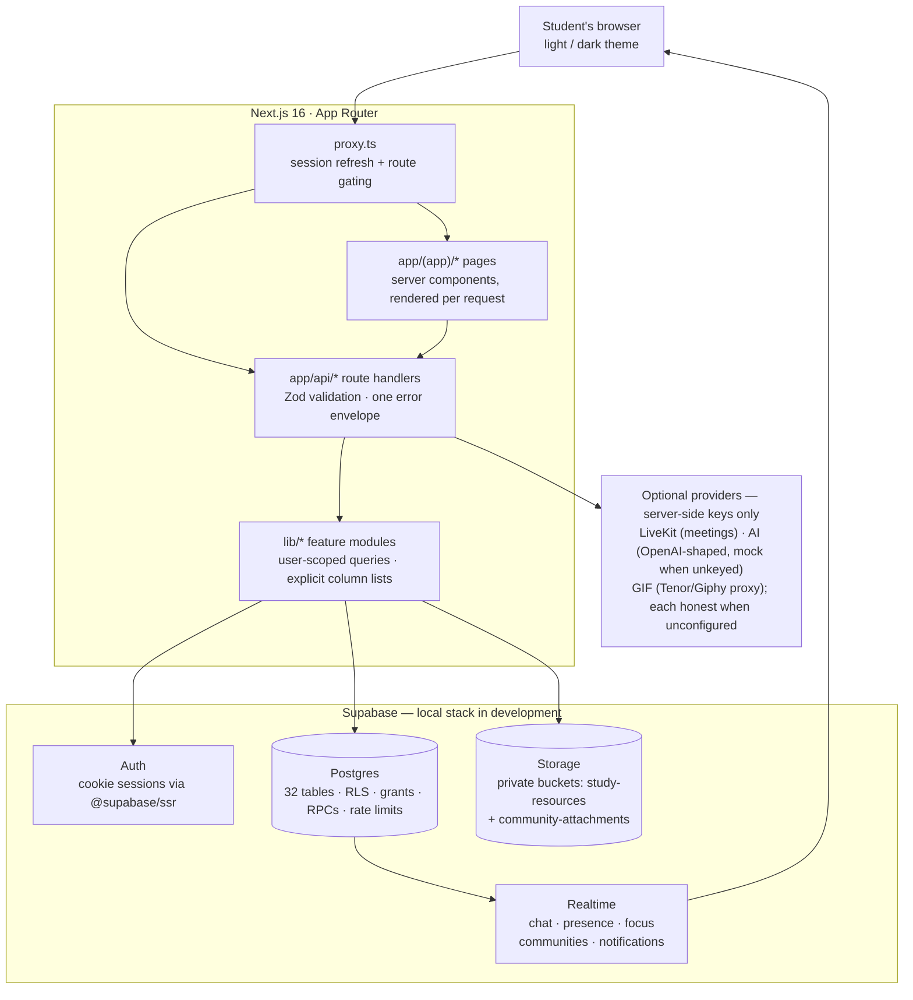
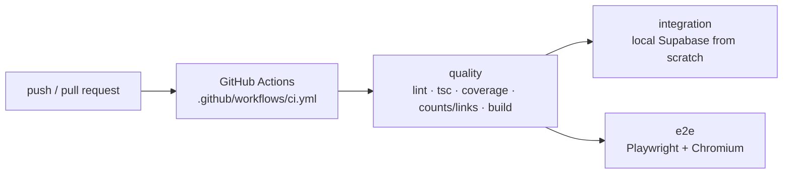

<p align="center">
  
</p>

<h1 align="center">SdyRoom</h1>

<p align="center">
  <strong>Study together. Stay accountable. Achieve more.</strong>
</p>

<p align="center">
  A collaborative study platform for exam prep — capacity-limited study rooms with
  shared focus timers, goals, realtime chat and private files; end-to-end encrypted
  communities; optional live meetings; AI study tools — built with Next.js and Supabase.
</p>

<p align="center">
  <a href="https://github.com/chanukyareddygopala07/sdyroom/actions/workflows/ci.yml"></a>
  <a href="LICENSE"></a>
  <a href="https://nextjs.org"></a>
  <a href="https://www.typescriptlang.org"></a>
  <a href="https://supabase.com"></a>
  <a href="https://tailwindcss.com"></a>
</p>

<p align="center">
  <a href="#features"><strong>Features</strong></a> ·
  <a href="#demo"><strong>Demo</strong></a> ·
  <a href="#architecture"><strong>Architecture</strong></a> ·
  <a href="#security"><strong>Security</strong></a> ·
  <a href="#testing"><strong>Testing</strong></a> ·
  <a href="#getting-started"><strong>Getting Started</strong></a> ·
  <a href="#deployment"><strong>Deployment</strong></a> ·
  <a href="#documentation"><strong>Documentation</strong></a> ·
  <a href="#contributing"><strong>Contributing</strong></a>
</p>

##  What is SdyRoom?

SdyRoom is a study-together platform for students preparing for competitive and
university examinations — JEE, NEET, GATE, semester exams and more. Sign up with a
password or a Google/GitHub account, pick a unique **study alias** once (your email
is never shown to anyone), discover public study rooms or create your own
capacity-limited room, and study "together" with a shared focus timer, personal
goals, realtime chat and private file sharing. Students can also form
**communities** — groups whose messages, stickers, files and GIFs are
end-to-end encrypted in the browser so the server only ever stores ciphertext —
and meet face-to-face in optional **LiveKit audio/video meetings** with screen
sharing.

**The problem it solves:** students rarely lack content — they lack consistent
habits, focused sessions, study partners and accountability. SdyRoom makes studying
alone feel less alone **without** requiring anyone to share a phone number, email or
social profile: collaboration happens through aliases inside authenticated rooms,
guarded by database-level authorization, so it is privacy-first by construction.

Built with **Next.js 16 (App Router)** and **Supabase** (Auth, Postgres with Row
Level Security, Storage, Realtime).

<a name="features"></a>

##  Features

###  Implemented

-  Password authentication with cookie sessions (`@supabase/ssr`), Google/GitHub
  sign-in through Supabase OAuth (owner-configured — a provider that is not
  enabled shows an honest "not available" state), password reset by email, and
  a one-time study-alias onboarding
-  Public room discovery with `?q=` search over name, subject and exam track
-  Capacity-limited rooms (1–100 seats), public/private and open/closed, with
  owner-only settings and type-the-name deletion
- ⏱ Shared focus sessions: an owner-driven timer state machine in Postgres, synced
  in realtime, with history and server-persisted expiry
-  Personal goals that stay private even from the room owner
-  Realtime room chat: append-only, cursor-paginated, RLS-filtered at delivery
-  Live presence on the roster (who is in the room / studying)
-  Alias-addressed invitations with an inbox — no invite links to forward or
  enumerate
-  Study resources: personal library + room sharing, magic-byte validation,
  20 MiB ceiling, 300-second signed downloads, storage quotas, rate limits and
  orphan cleanup
-  Ask my notes: room-scoped questions over indexed documents with real
  citations, per-user history, and a daily AI budget (PR 13)
-  AI quizzes and flashcards: generated revision quizzes and flashcard decks
  over your indexed documents, server-side scoring, and a spaced-repetition
  schedule (PR 14)
-  AI study planner: a personal day-by-day plan built from your exam date,
  hours and topics — grounded in your indexed room documents with real
  citations, plus deterministic shift / mark-done / regenerate adjustments that
  never touch the AI (PR 15)
-  Study analytics: a personal dashboard of focus time, current/longest
  streaks, quiz accuracy, plan progress and cards due — with a 7/30/90-day
  range switch and CSV export — plus room-level aggregates (counts and minutes
  only) for owners and moderators (PR 16)
-  Advanced room discovery: URL-driven search, subject/exam/language/size
  filters and sort (best match, newest, most active, largest, name) over
  public rooms only, cursor "Load more" paging, and a public-safe room
  preview page that 404s a private room exactly like a missing one (PR 17)
-  Member safety: reports, one-way blocks, mutes, member removal, owner-appointed
  room moderators, and a moderation inbox that never shows the reporter
-  In-app notifications: an inbox with an unread badge in the header, produced
  server-side by invitations and moderation actions (the `notifications` table
  grants no `INSERT` to any application role — the two SECURITY DEFINER
  producers write it), with per-type delivery preferences (PR 11)
-  Communities: public or private groups with categories, join rules
  (open / request-to-join), owner / moderator / member roles, approvals,
  kicks, bans, staff moderation reports and per-community channels — plus
  **end-to-end encrypted channels**: MLS via `ts-mls` (ciphersuite
  `MLS_128_DHKEMX25519_AES128GCM_SHA256_Ed25519`) encrypts message bodies,
  stickers and reactions on the device, files and GIFs are AES-256-GCM
  encrypted before upload, each device publishes key packages, and welcomes
  carry the RFC 9420 ratchet tree. **`ts-mls` has not undergone an
  independent security audit** — see [Security](#security); membership,
  timings, sizes and device ids remain visible to the server by design
-  Live meetings: a **Meeting** view in the room workspace — audio/video calls
  with screen sharing through LiveKit, joined with a short-lived token minted
  per request. Externally configured: without the three `LIVEKIT_*` keys the
  toggle is disabled with an explanation and the token endpoint answers an
  honest `503 meeting_unavailable` (PR #36)
-  Profile & settings: a student edits their study alias (reflected in the
  header and room rosters), exam targets and preferred language from shared
  vocabularies, notification preferences, and reads their account email (PR 20)
- Light and dark themes

<a name="planned"></a>

###  What's next

Every specification PR in the roadmap has shipped — GitHub PRs #1–#38 are
merged except #16, a leftover docs-status branch, which was closed without
merging.
What remains is operational rather than code: a hosting and deployment
decision, branch protection on `main`, and the launch drills recorded in
[`docs/RELEASE.md`](docs/RELEASE.md). Product planning continues in
[`docs/PR_ROADMAP.md`](docs/PR_ROADMAP.md) and
[`docs/milestones.md`](docs/milestones.md).

<a name="different"></a>

##  What makes SdyRoom different

- **Privacy-first identity.** Students collaborate behind a one-time alias —
  no email, phone number or social profile is ever shown to another student,
  and no endpoint accepts an identity as input.
- **The database is the authority.** Row Level Security, column grants and
  `SECURITY DEFINER` RPCs enforce every rule server-side; the API re-checks
  rather than trusts. No service-role key exists anywhere in the application
  code or CI.
- **Encrypted communities, honestly scoped.** Community chat and files are
  end-to-end encrypted in the browser while the server keeps only ciphertext —
  with the explicit caveat that `ts-mls` is not independently audited and
  metadata stays server-visible.
- **Honest states instead of fake success.** Unconfigured integrations disable
  themselves with an explanation (AI demo mode, meetings `503`, hidden GIF
  tab); failures answer through one error envelope with stable codes.
- **Addressed, not linkable.** Invitations go to an alias — there is no URL to
  forward — and a non-member sees the same `404` as a missing room.
- **Tested like infrastructure.** 2,488 tests across unit, integration and e2e
  suites, coverage floors enforced in CI, RLS/grant freezes in the integration
  suite, and documentation gates that fail when documented counts drift.

<a name="demo"></a>

##  Screenshots & Demo

No screenshots or demo recordings are checked in yet, and this repository does not
host a public deployment — so there is no live demo link to click. Run it locally
instead: [Getting Started](#getting-started).

<!-- TODO: add real screenshots/GIFs under docs/images/ and reference them here, e.g.
     <div align="center"></div>
     See docs/images/README.md for naming and size conventions. -->

<a name="architecture"></a>

##  Architecture

Two rules describe the whole design (from
[`docs/ARCHITECTURE.md`](docs/ARCHITECTURE.md)):

1. **Authorization lives in the database.** Row Level Security policies and
   `SECURITY DEFINER` RPCs re-check every rule server-side, and the API re-checks
   the same rule before it answers — a bug in one layer leaves the other standing.
2. **Identity is never a parameter.** Handlers read the Supabase session claims;
   RPCs read `auth.uid()`; nothing accepts "on behalf of" input.



A typical request: `proxy.ts` refreshes the session (sending unauthenticated
visitors to `/auth/login`, except `/`, `/auth/*` and `/api/*`), the page or handler
validates input with Zod, a `lib/` module runs the query through the user-scoped
Supabase client, Postgres re-authorizes it through RLS / grants / RPCs, and the
response is shaped with an explicit column list — failures answer through the single
error envelope `{ error: { code, message, issues? } }`.

CI mirrors that shape:



### How the pieces fit together

- **Session**: `proxy.ts` → `lib/supabase/proxy.ts#updateSession` refreshes cookies
  and sends unauthenticated visitors (everything except `/`, `/auth/*` and `/api/*`)
  to `/auth/login`. API routes are exempt on purpose so a `fetch` client gets the
  documented JSON `401` instead of an HTML redirect. Each session-gated page re-checks the session and, for rooms, the
  profile row; they export `instant = false` because the project runs with
  `cacheComponents` and these routes must render per request.
- **Validation**: `lib/validation/` (Zod) mirrors the CHECK constraints in
  `supabase/migrations/0001_init.sql`, so bad input is rejected in the browser, at
  the API boundary and again in the database.
- **Database access**: `lib/profiles/queries.ts` and `lib/rooms/` — public rooms are
  read with an explicit column list and mapped through `toPublicRoom()`, so
  `owner_id` and any future private column can never reach a response. Rooms are
  only ever created through the `create_room` RPC, and membership only through
  `join_room` / `leave_room`: the owner (or the caller) is always taken from
  `auth.uid()` and never accepted from the client, and the seat check shares a row
  lock with the insert so racing students cannot exceed `capacity`. Occupancy is an
  aggregate over public rooms only (`public_room_member_counts`), so no participant
  identity or private-room count is ever disclosed.
- **Focus sessions**: `lib/focus/` reads through `focus_session_state` and writes
  through `start` / `pause` / `resume` / `end`, all owner-checked inside the
  database. A partial unique index allows at most one active session per room, so a
  concurrent race resolves to `already_active` instead of a second row, and
  `toFocusSession()` re-validates every payload (paused ⇔ `paused_at`, finished ⇔
  `ended_at`) before it reaches a client. The workspace page subscribes to realtime
  changes on `focus_sessions`, polls as a fallback and re-reads the same
  `getFocusWorkspace` the server rendered with, so a reconnect can never restart or
  rewind a timer.
- **Personal goals**: `lib/goals/` addresses only the caller's own rows; the partial
  unique index on `(user_id, room_id, lower(title)) where status = 'active'` yields
  `409 duplicate_goal`, the title frees up on completion, and a trigger owns
  `completed_at` / `updated_at`.
- **Room chat**: `lib/chat/` seeds history from the workspace page and appends
  through `POST /api/rooms/[id]/messages`; `room_messages` is append-only (only
  `SELECT`/`INSERT` are granted), the sender is pinned to `auth.uid()` by RLS and
  never returned as an id — the API maps it onto the viewer-relative `is_own` — and
  `seq` gives a stable total order for `before=` cursor pagination. Rows reach
  members over `supabase_realtime`, with RLS applied at delivery, and the client
  deduplicates by id because a send can be confirmed by both the POST response and
  its own event.
- **Study resources**: `lib/resources/` validates the file (magic bytes, 20 MiB
  ceiling, filename shape, unknown multipart parts rejected outright), builds the
  storage key from server-generated UUIDs only, and writes the object *before* the
  metadata row — a failed insert rolls the object back, so no orphan is advertised.
  The same scope is enforced twice, independently: table RLS for the metadata and
  storage RLS for the bytes, both derived from `auth.uid()` and current room
  membership, so a direct PostgREST or Storage call obeys exactly what the app
  obeys. `owner_id` holds no grant at all, and `storage_path` is excluded from the
  response column list. Abuse controls run in cost order: fixed-window rate limits
  (`rate_limits` table, written by `rate_limit_take`), a fail-open quota pre-check
  that refuses an over-budget upload before the bytes are written, and the
  `study_resources_quota_guard` trigger that re-decides inside the inserting
  transaction so concurrent uploads cannot race past a quota.
- **Invitations and the roster**: `lib/invitations/` addresses each invitation to
  one student's alias — there is no token, link or invite URL, so nothing can be
  forwarded or enumerated, and every transition re-derives `auth.uid()` inside a
  `SECURITY DEFINER` RPC (`0007`). The table is read-only for clients (no write
  grant), expiry is evaluated at read time (`410`, never a stored state), at most
  one pending invitation per (room, invitee) is allowed by a partial unique index,
  and acceptance seats through the same row-locked capacity code as `join_room`
  with a private gate no client can execute. The roster reads through the
  membership-checked `room_roster` RPC — `room_members` visibility is unchanged —
  and annotates rows with live presence from the PR 06 channel.
- **Member safety**: `lib/moderation/` reports, blocks, mutes, removals and
  room-moderator appointment through alias-addressed SECURITY DEFINER RPCs
  (`0009`) with no `INSERT`/`UPDATE` grant on the audit tables — the reporter is
  pinned to `auth.uid()` inside the RPC and has no column grant, so no payload
  can carry it; blocks are private to the blocker and filter that user's chat
  through one clause on the `room_messages` SELECT policy (history and live
  arrival alike); mutes are re-checked by the insert policy, so a direct
  PostgREST write cannot bypass them. There is no global admin role: every
  right is scoped to one room.
- **Communities (end-to-end encrypted)**: `lib/communities/` gates discovery,
  visibility and membership server-side with the same `404` parity as rooms —
  `community_members` carries a `SELECT`-alone grant, so create / join /
  leave / role changes / kicks travel through SECURITY DEFINER RPCs
  (`0025`) and self-promotion is structurally unreachable. Message bodies are
  a different story: they are MLS-encrypted on the device before `POST
  …/channels/[channelId]/messages` ever runs, and the handler validates
  envelope shape, size, rate-limit window and membership before inserting
  **ciphertext** (a repeated `clientMsgId` is idempotent). Files and GIFs are
  AES-256-GCM encrypted in the browser, stored in the private
  `community-attachments` bucket, and served as 120-second signed URLs only
  after a server re-check. Devices publish key packages for peers' Add
  commits, welcomes address the ratchet tree to one recipient, and a leaving
  member's local MLS state is wiped — the Remove commit is produced by a
  *surviving* member's next sync, because `ts-mls` forbids committing one's
  own removal. Reports are the deliberate opt-in exception: a voluntary
  decrypted excerpt of at most 2 000 characters.
- **Optional providers, honestly off**: everything outside Supabase is
  server-keyed and fails closed — `lib/ai/config.ts` (mock pipeline with a
  demo banner when unkeyed, never a silent fallback), `lib/meeting/config.ts`
  (LiveKit: disabled Meeting toggle + `503 meeting_unavailable`) and
  `lib/communities/gif.ts` (Tenor/Giphy behind `/api/communities/gif/*`
  with a host allow-list and 5 MiB cap; the tab hides when unconfigured).
  Keys are read server-side only and never appear in `NEXT_PUBLIC_*`.
- **Errors**: one envelope for every API failure, `{ error: { code, message, issues?
  } }`, built by `lib/api/responses.ts`.

**Layout note:** the original brief assumed a `src/` tree (`src/lib/...`). This
repository keeps the starter's root-level `app/`, `lib/` and `components/`, so those
modules live at `lib/validation/`, `lib/rooms/`, `lib/profiles/` and `lib/api/`
instead of `src/lib/...`. Route and test paths are otherwise unchanged.

For the full directory map, data model (32 tables) and where decisions live, read
[`docs/ARCHITECTURE.md`](docs/ARCHITECTURE.md).

<a name="security"></a>

##  Security

- **Server-side auth gates**: pages are session-gated (middleware redirect for
  browsers, JSON `401` for APIs); every room endpoint re-checks membership, and a
  non-member gets the same `404` as a missing room (`lib/rooms/access.ts`).
- **The database is the authority**: all 32 tables are RLS-enabled and granted
  column by column (`auto_expose_new_tables = false`); privileged writes go through
  `SECURITY DEFINER` RPCs; there is no `USING (true)` policy anywhere, and identity
  is never accepted as a request parameter.
- **Private file storage**: the `study-resources` bucket is `public = false`;
  downloads are 300-second signed URLs issued only after the server re-checks
  access; content types come from magic-byte sniffing; uploads are limited by
  per-user and per-room quotas plus fixed-window rate limits, and failed writes are
  swept by an orphan cleanup.
- **Chat and moderation privacy**: chat is append-only; blocks filter at RLS
  delivery; mutes are re-checked by the insert policy; `reporter_id` has no
  `SELECT` grant, so no payload can leak who filed a report.
- **End-to-end encrypted communities — what is actually protected**: message
  bodies, stickers, reactions and file/GIF payloads are encrypted on the
  device before they leave it. The protocol is MLS through `ts-mls@1.6.4`,
  ciphersuite `MLS_128_DHKEMX25519_AES128GCM_SHA256_Ed25519`; attachments and
  GIFs use AES-256-GCM envelopes whose keys travel inside the E2EE payload.
  Postgres stores ciphertext only, and Realtime delivers ciphertext rows
  filtered by the `messages_select_member` policy at delivery. Attachments
  download through 120-second signed URLs re-checked server-side per request.
  **`ts-mls` has not undergone an independent security audit — this project
  makes no independently-verified encryption claim.**
- **Communities — what the server still sees, and the limits**: all metadata
  stays plaintext by design — membership and roles, channel structure,
  message timing and sizes, sender device ids — and the GIF search query
  leaves the server toward the provider. Key lifecycle: devices publish
  public key packages, welcomes are addressed to one recipient, and a leaver's
  local MLS state is wiped (the Remove commit comes from a *surviving*
  member's next sync, since MLS forbids self-removal). A member removed while
  offline still holds messages from epochs they legitimately had; there is no
  escrow, so losing every device makes history unrecoverable; and each
  device caches the student's *own* sent messages as plaintext (MLS senders
  cannot re-decrypt their own envelopes), so a compromised device exposes that
  student's own community history. Community reports carry a voluntary,
  opt-in decrypted excerpt of at most 2 000 characters — the one deliberate
  plaintext escape hatch. Full threat model and test evidence:
  [`docs/SECURITY.md`](docs/SECURITY.md) §Communities.
- **No secrets at runtime**: no service-role key exists in application code, CI runs
  with `permissions: contents: read` and zero repository secrets, and `.env.local`
  is gitignored.
- **Honest failures**: one error envelope, stable error codes, no stack traces in
  responses.

Read the threat model, security coverage and known limitations in
[`docs/SECURITY.md`](docs/SECURITY.md). To report a vulnerability, follow
[`SECURITY.md`](SECURITY.md) — please do not open a public issue.

<a name="technology"></a>

##  Technology

| Layer | Choice |
| --- | --- |
| Framework | [Next.js](https://nextjs.org) 16.3.8 — App Router, `cacheComponents`, Proxy |
| Language | [TypeScript](https://www.typescriptlang.org) 5.9.3 (strict) |
| Backend | [Supabase](https://supabase.com) — Auth, Postgres + RLS, Storage, Realtime; pinned CLI 2.119.0 for the local stack |
| Live meetings | [LiveKit](https://livekit.io) — `livekit-client` 2.23.0, `livekit-server-sdk` 2.19.1, `@livekit/components-react` 2.9.24 (bring your own LiveKit server or cloud keys) |
| Community encryption | [ts-mls](https://www.npmjs.com/package/ts-mls) 1.6.4 (MLS) plus WebCrypto AES-256-GCM for attachments — **not independently audited** |
| Validation | [Zod](https://zod.dev) 4.6.5, mirroring the database CHECK constraints |
| Styling | [Tailwind CSS](https://tailwindcss.com) 4.3.3 + [shadcn/ui](https://ui.shadcn.com/) on Radix UI |
| Tests | [Vitest](https://vitest.dev) 5.0.3 (unit + integration), [Playwright](https://playwright.dev) 1.63 (e2e), Testing Library |
| Linting | ESLint 9 flat config via `eslint-config-next` 16.3.8 |

### Visual system

- **Logo (source of truth)**: `docs/images/sdyroom-logo.png` (1254×1254
  RGBA). The app serves downscale-only copies from `public/images/`
  (`sdyroom-logo.png`, `sdyroom-logo-256.png`); the favicon and
  `app/icon.png` are derived from the same artwork. Never redraw, recolour
  or distort the mark — scale only.
- **Tokens**: `app/globals.css` owns the Tailwind v4 `@theme` mapping and
  the HSL variables for both themes. Dark mode is the brand's home surface
  (ground sampled from the logo, `#030617`); light mode is a cool-paper
  counterpart. Every foreground/background pair is WCAG 2.2 AA-checked.
- **Brand gradients**: `bg-gradient-brand` (blue → violet, the logo's door
  ramp — both endpoints keep white text above 4.5:1), plus
  `bg-gradient-brand-soft`, `text-gradient-brand`, `divider-gradient` and
  the decorative `bg-glow-brand` wash used behind the hero and auth
  screens.
- **Theming**: `next-themes` (class strategy, system default); the footer
  switcher flips between light and dark.

### Pinned dependency versions

All dependencies are pinned to exact versions (no `^`, `~` or `latest`) in
`package.json` — with two deliberate exceptions: `ts-mls` (`^1.6.4`, runtime)
and `fake-indexeddb` (`^6.2.2`, dev).

| Package | Version |
| --- | --- |
| next | **16.3.8** |
| react / react-dom | 19.3.0 |
| typescript | 5.9.3 |
| zod | 4.6.5 |
| @supabase/ssr | 0.12.7 |
| @supabase/supabase-js | 2.117.2 |
| supabase (CLI, devDependency) | 2.119.0 |
| tailwindcss | 4.3.3 |
| @tailwindcss/postcss | 4.3.3 |
| eslint-config-next | 16.3.8 |
| vitest | 5.0.3 |
| vite | 8.3.2 on this branch (`main` has 8.3.4 after the PR #37 bump) |
| jsdom | 30.1.2 |

**Next.js 16.3.8 is an intentional, security-driven deviation from the originally
specified 16.3.4.** 16.3.8 is the patched release on the 16.3.x line and is what the
approved Supabase starter resolves to; keep this pin and do not downgrade to 16.3.4.

`eslint-config-next` is pinned to **16.3.8 to match Next.js 16.3.8** (it must stay on
the same release as `next`). It ships a native flat config, which `eslint.config.mjs`
spreads directly — `FlatCompat`/`@eslint/eslintrc` is no longer used.

### Tailwind CSS 4

Styling runs on **Tailwind CSS 4.3.3** with `@tailwindcss/postcss` (PostCSS plugin).
The migration replaced the v3 trio (`tailwindcss` + `autoprefixer` + `tailwind.config.ts`):

- `postcss.config.mjs` uses `@tailwindcss/postcss` only; `autoprefixer` was removed
  (Tailwind 4 emits vendor prefixes itself).
- `app/globals.css` is CSS-first: `@import "tailwindcss"`, `@plugin "tailwindcss-animate"`,
  `@custom-variant dark` for the class-based dark mode, and `@theme inline` for the
  shadcn colour/radius tokens (the `--radius-*` and `hsl(var(--*))` values match the
  old JS config).
- `tailwind.config.ts` was deleted; source detection is automatic.
- Class renames for v4: `shadow` → `shadow-sm`, `shadow-sm` → `shadow-xs`,
  `outline-none` → `outline-hidden`, `bg-gradient-*` → `bg-linear-*`, and the removed
  `origin-[--var]` shorthand → `origin-[var(--var)]`.

### npm audit

`npm audit --omit=dev` (production dependencies): **0 vulnerabilities**.

`npm audit` (all dependencies): **6 high** on this branch — five in one
dev-toolchain chain rooted in a single advisory:

| Advisory | Package | Range |
| --- | --- | --- |
| [GHSA-vfj7-8cjw-p6xm](https://github.com/advisories/GHSA-vfj7-8cjw-p6xm) — stack-exhaustion DoS via deeply nested patterns (high) | `braces` | `<=3.0.3` |

Propagation: `braces` ← `micromatch` ← `fast-glob` ← `@next/eslint-plugin-next@16.3.8`
← `eslint-config-next@16.3.8`.

`braces@3.0.3` is the newest release on npm, so **no fixed version exists yet**; npm's
only suggested resolution is a downgrade of `eslint-config-next` to 14.2.35, which is
rejected. Nothing is suppressed and `--force` / `--legacy-peer-deps` are not used.

A second dev-toolchain chain exists around vite: `vite 8.3.0–8.3.2` →
`launch-editor` (three Windows-specific advisories in editor-command
handling) — the sixth high on this branch. `main` bumped vite to 8.3.4
(PR #37), outside that vulnerable range, so `npm audit` shows **5 high**
there; npm's suggested fix (8.3.5) sits outside the exact pin and is not
taken blindly. Re-check `npm audit` on every dependency update: the braces
count fell from 7 to 5 with the Tailwind CSS 4 migration (removing the
`tailwindcss@3` → `chokidar` → `braces` path).

<a name="testing"></a>

##  Testing

Current suite: **1935 unit** (171 files), **465 integration** (26 files), **88 e2e**
(23 specs).

- `npm test` (alias `npm run test:unit`) runs `vitest run` over `tests/unit/**` in the
  Node environment. It never contacts Supabase and passes without a local stack running.
  Individual UI test files opt into jsdom with a `@vitest-environment jsdom` docblock.
- `npm run test:integration` runs `vitest run --config vitest.integration.config.ts`
  over `tests/integration/**` — 465 tests covering auth at the API boundary, onboarding
  and response privacy, RLS/grant behaviour per role, `create_room` atomicity
  (including the revoked-grant rollback), joining and capacity races, the shared focus
  timer state machine, personal-goal privacy, append-only room chat, the whole
  study-resource authorization model (private library, room sharing, revocation on
  leaving, signed URLs, impersonation of another student's folder, bucket privacy),
  live Realtime delivery of `focus_sessions` changes over a real WebSocket, the
  addressed-invitation lifecycle (create/accept/reject/revoke/expiry, the last-seat
  accept race, roster denial for non-members, policy and grant freezes), room
  management, member moderation (report workflow with reporter privacy, mute
  lifecycle with the direct-insert control, moderator appointment, one-way block
  filtering, member removal, audit-row and grant probes, cross-room isolation), and
  resource hardening (the `rate_limits` freeze with a grant-revoke control, `413`/`415`,
  the bucket's own oversized-put refusal independent of the app,
  upload/delete/sweep `429`s, both orphan-sweep directions, the quota chain
  including a two-upload race resolved by the database trigger, and the
  signed-download serve review), profile settings (alias/targets/language
  persistence with read-back, a hostile body refused with the row
  byte-identical, the database floor on protected fields, roster reflection
  for a room-mate, preferences honored by the real invite producer, and the
  `profile:{userId}` window) — and meeting tokens end to end (the
  membership-gated mint with its room-scoped JWT claims, the muted member's
  microphone-less grant until the mute lifts, the indistinguishable `404`s,
  the honest `503` while unconfigured, and the per-room `429` burst) — and
  communities end to end (the SELECT-only membership freeze with the owner-only
  `communities` delete and the six-definer-RPC privilege matrix including
  `community_roster`, the three named storage policies, creation validation and
  slug `409`, private-row `404` parity, join/request flows, opaque idempotent
  message envelopes and addressed welcomes, device registration with sync and
  key packages, reporter/staff-scoped reports, member-only signed attachments,
  bans/kicks/leaves/owner deletion, and the create-window `429`) —
  every suite shares a single control test that widens a grant and rolls it back.
  It needs
  the local stack (`npx supabase start && npx supabase db reset`) and never uses a
  service-role key. `passWithNoTests` stays unset, so a missing suite still exits
  non-zero. See `tests/integration/README.md`.
- `npm run test:e2e` runs `playwright test` over `tests/e2e/**` — 88 Chromium tests
  driving the real app (`next dev`) against the local stack: the full two-student
  workflow through the forms, private-room access, room chat, room presence across
  two browsers, the invitation lifecycle (invite by alias → inbox → accept, stranger
  negatives, reject/revoke/expiry, a full room), the upload → share →
  revoke → delete file lifecycle through the real upload form, room settings →
  close → name-typed delete across two browsers, expiry/failure/recovery
  scenarios, Realtime-vs-polling proven on an intercepted WebSocket (including
  stale and duplicate frame replay), member safety (message report → owner's
  moderation inbox → review → resolve with no reporter identity shown, one-way
  block filtering, owner mute → disabled composer → removal to a 404, and the
  documented refusal codes for anonymous, non-member and plain-member API
  attempts), and resource hardening (oversize/extension preflights failing in the
  browser, the quota line and quota-full locking, and a spent upload window
  answered with `429` + `Retry-After`), and settings (the alias change
  announced and reflected in the header and the room roster, exam targets and
  language persisted across a read-back, a notification preference surviving a
  reload, invalid aliases surfacing inline `role="alert"` errors, and sign-out
  from the account section guarding the app afterwards), accessibility (axe
  scans over the public, auth, discovery, settings and workspace surfaces),
  live meetings (the honest unavailable state with no LiveKit keys — the
  live-join spec skips without a server), and the encrypted
  community journey in two real browsers (owner creates a community and
  bootstraps its channel group, a second student joins and is honestly locked
  until the owner's next sync Adds their device and addresses the welcome,
  pre-join history staying opaque and saying so, then messages crossing both
  browsers live). Test users are scoped to a per-run id and deleted
  by the global teardown (which also removes this run's storage objects before its
  `auth.users` rows). It needs the local stack plus `npx playwright install chromium`.
  See `tests/e2e/README.md`.
- `.github/workflows/ci.yml` runs all three suites on every push and pull request: a
  `quality` job (lint, env contract, types, unit tests with coverage floors,
  doc-count and doc-link checks, build — no env or secrets; `coverage/lcov.info` is
  uploaded as an artifact) and — each after
  `quality` — an `integration` job (which also re-checks the documented
  per-file counts against its run's JSON) and an `e2e` job that stand up their own
  isolated local Supabase, apply migrations from scratch and run their suite (the
  e2e job also installs Chromium and uploads the Playwright report on failure). All jobs use the
  Node version pinned in `.nvmrc`, and the workflow is `permissions: contents: read`
  with no repository secrets.

See [`CONTRIBUTING.md`](CONTRIBUTING.md) for the exact commands to run before you
open a pull request.

<a name="roadmap"></a>

##  Roadmap

| Status | PRs |
| --- | --- |
|  Merged | #1–#15 and #17–#38 — the whole product through end-to-end encrypted communities (#38): rooms, focus sessions & goals, chat, presence, invitations & roster, room management, moderation, resource hardening, notifications, the AI stack (documents → ask → quizzes → planner → analytics), discovery, production hardening, responsive shell & accessibility, profile & settings, quality/coverage gates, release & staging runbooks, chat-history reconciliation, retention cron, brand/auth/landing redesigns, LiveKit meetings, and communities |
|  Closed | #16 — a leftover docs-status branch, closed without merging |
|  Open | none — every spec PR and follow-up has landed |

Details, order and acceptance criteria:
[`docs/PR_ROADMAP.md`](docs/PR_ROADMAP.md) ·
[`docs/milestones.md`](docs/milestones.md) ·
[project wiki](https://github.com/chanukyareddygopala07/sdyroom/wiki)

<a name="getting-started"></a>

##  Getting Started

### Prerequisites

- **Node.js 24** (the version pinned in `.nvmrc`) and npm
- **Docker** — the local Supabase stack runs in containers (several GB of disk)
- `npx playwright install chromium` before running e2e tests

### Run locally

```bash
git clone https://github.com/chanukyareddygopala07/sdyroom.git
cd sdyroom
npm ci
```

1. Copy `.env.example` to `.env.local` and fill it from the local stack
   (`npx supabase status -o env`) — only two public, browser-safe values:

   ```env
   NEXT_PUBLIC_SUPABASE_URL=http://127.0.0.1:54321
   NEXT_PUBLIC_SUPABASE_PUBLISHABLE_KEY=<local publishable key>
   ```

   The AI variables are optional, server-side only (never `NEXT_PUBLIC_*`),
   and are read in one place — `lib/ai/config.ts`:

   | Variable | Default | Notes |
   | --- | --- | --- |
   | `AI_PROVIDER` | `auto` | `auto` \| `openai` \| `mock`. `auto` picks `openai` when `AI_API_KEY` is set and `mock` when it is not |
   | `AI_API_KEY` | — | Provider key. Never logged, never in a payload, never exposed to the browser |
   | `AI_BASE_URL` | `https://api.openai.com/v1` | Any OpenAI-shaped endpoint; ops can switch providers without a code change |
   | `AI_EMBED_MODEL` | `text-embedding-3-small` | Embedding dimension is fixed at **1536** for this model class — changing models needs a new migration and a full re-embed |
   | `AI_CHAT_MODEL` | `gpt-4o-mini` | Used by the later completion features (PR 13+) |
   | `AI_MAX_INGEST_BYTES` | `20971520` (20 MiB) | Ingest ceiling; clamped to the 20 MiB upload ceiling no matter what is configured |

   The rule: **no key configured → the mock provider runs the whole pipeline**
   and a demo-mode banner is shown app-wide; **a configured provider never
   silently falls back to mock** — a broken key fails loudly as
   `502 ai_provider_failed`.

   Live meetings are the same shape of optional, server-side-only feature —
   read in one place, `lib/meeting/config.ts`, and never `NEXT_PUBLIC_*`:

   | Variable | Notes |
   | --- | --- |
   | `LIVEKIT_URL` | The LiveKit server endpoint, `ws://` or `wss://` (a typo counts as unconfigured, logged by variable name only) |
   | `LIVEKIT_API_KEY` | Token-signing issuer |
   | `LIVEKIT_API_SECRET` | Token-signing secret. Server-only; never logged, never in a payload, never exposed to the browser |

   All three are required together: with none of them the room workspace
   simply disables the Meeting view with an explanation, and the token
   endpoint answers an honest `503 meeting_unavailable`. Local development
   can run [LiveKit's local server](https://docs.livekit.io/home/self-host/local-deployment)
   (`docker run ... livekit/livekit-server --dev`, then
   `LIVEKIT_URL=ws://localhost:7880` with the dev keys), or point at a
   LiveKit Cloud project.

   The community composer's GIF search is the same shape — two keys read
   together in `lib/communities/gif.ts`, never `NEXT_PUBLIC_*`:

   | Variable | Notes |
   | --- | --- |
   | `GIF_PROVIDER` | `tenor` or `giphy` |
   | `GIF_API_KEY` | Provider credential — never logged, never sent to the browser; the browser only calls `/api/communities/gif/*` |

   Both empty → the GIF tab hides and the proxies answer `503
   gif_unavailable`. Local setup: a free Tenor or Giphy key; details in
   [`docs/DEVELOPMENT.md`](docs/DEVELOPMENT.md) ("GIF search (communities)").

2. Start the local stack and apply every migration:

   ```bash
   npx supabase start
   npx supabase db reset
   ```

3. Start the app:

   ```bash
   npm run dev
   ```

   The app runs on [localhost:3000](http://localhost:3000/).

### Scripts

| Script | What it does |
| --- | --- |
| `npm run dev` | Next.js dev server |
| `npm run build` | Production build |
| `npm start` | Serve the production build |
| `npm run lint` | ESLint (flat config) |
| `npx tsc --noEmit` | Type check (what CI runs; there is no `typecheck` script) |
| `npm test` / `npm run test:unit` | Unit suite (no network, no stack needed) |
| `npm run test:integration` | Integration suite (needs the local stack + `db reset`) |
| `npm run test:e2e` | Playwright e2e (needs the local stack + Chromium) |
| `npm run check:env` | Static check: every `process.env` read in `lib/`/`app/` is covered by `.env.example` (also runs in CI) |
| `npm run smoke` | Five HTTP checks against a running server: `/api/health`, `/api/health/ready`, `/api/metrics`, error-envelope `request_id` echo, malformed `x-request-id` replacement (`SMOKE_BASE_URL`) |
| `npm run load:sanity` | Load smoke: `LOAD_TOTAL` requests at `LOAD_CONCURRENCY`, p50/p95/p99, fails below 99% success (`LOAD_BASE_URL`) |

### Local Supabase

The database foundation runs entirely locally through the pinned CLI
(`npx supabase start`), with Postgres on port **54322** — never the Homebrew server on
5432 — and every migration (`0001`–`0025`, one append-only file per schema
change) applies with `npx supabase db reset`. `supabase/seed.sql` is
intentionally empty: no demo data ships. See
[docs/local-supabase.md](docs/local-supabase.md) for the 32-table schema,
grants, RLS policies, both private buckets (`study-resources`,
`community-attachments`) with their storage policies, the SECURITY DEFINER
RPCs (rooms, moderation, communities), how owner-membership atomicity is
enforced, and the verification commands.

<a name="deployment"></a>

##  Deployment

**Current status: no production deployment is recorded in this repository.**
There is no hosting configuration checked in (no `vercel.json` or equivalent),
CI runs with `permissions: contents: read` and zero secrets, and branch
protection is not enabled on `main` — so treat SdyRoom as self-hosted until
those decisions are made and recorded.

When you deploy:

- **Shape**: a Node.js 24 host (`.nvmrc`) running `npm run build` and
  `npm start`, or the Next.js-native platform of your choice, pointed at a
  hosted Supabase project. The only required variables are the two
  browser-safe `NEXT_PUBLIC_SUPABASE_*` values; `AI_*`, `LIVEKIT_*` and
  `GIF_*` are optional and each feature honestly disables itself without
  them. No service-role key is needed by the application.
- **Gates first**: the full checklist — lint, types, coverage floors, doc
  gates, build, integration, e2e, `npm run smoke` against the built server —
  plus the environment matrix and the launch checklist live in
  [`docs/RELEASE.md`](docs/RELEASE.md).
- **Staging**: a private staging shape (Vercel preview deployments plus a
  dedicated Supabase project, env scoping and `pg_cron` verification) is
  written up in [`docs/STAGING.md`](docs/STAGING.md).
- **Database**: hosted Supabase applies the same append-only migrations;
  verification commands and recovery gaps are documented in
  [`docs/local-supabase.md`](docs/local-supabase.md) and
  [`docs/RELEASE.md`](docs/RELEASE.md) (restore drills do not restore
  storage objects — the two buckets are outside `pg_dump`).

<a name="documentation"></a>

##  Documentation

| Document | What it answers |
| --- | --- |
| [Project wiki](https://github.com/chanukyareddygopala07/sdyroom/wiki) | Product vision, positioning and feature overview |
| [docs/ARCHITECTURE.md](docs/ARCHITECTURE.md) | How the layers fit together, directory map, data model |
| [docs/DEVELOPMENT.md](docs/DEVELOPMENT.md) | Day-to-day guide: suites, migrations, adding endpoints, LiveKit/GIF/OAuth setup |
| [docs/API_CONTRACTS.md](docs/API_CONTRACTS.md) | What every endpoint accepts and returns |
| [docs/SECURITY.md](docs/SECURITY.md) | Threat model, security coverage, known limitations |
| [docs/local-supabase.md](docs/local-supabase.md) | Local database: schema, grants, policies, verification |
| [docs/RELEASE.md](docs/RELEASE.md) | Pre-deployment gates, launch checklist, environment matrix, hosting selection, branch protection policy (proposed), rollback/recovery with known recovery gaps, evidence tiers, retention and backup/restore drills |
| [docs/STAGING.md](docs/STAGING.md) | Private staging setup (Vercel preview + dedicated Supabase project), env scoping, pg_cron verification, and the staging verification matrix |
| [docs/PR_ROADMAP.md](docs/PR_ROADMAP.md) · [docs/milestones.md](docs/milestones.md) | What shipped, what is next, in what order |
| [docs/prs/](docs/prs/) | Per-PR specifications and reconciliation notes |
| [tests/integration/README.md](tests/integration/README.md) · [tests/e2e/README.md](tests/e2e/README.md) | How the suites run and what they prove |
| [CONTRIBUTING.md](CONTRIBUTING.md) | Development workflow and pull-request checklist |
| [SECURITY.md](SECURITY.md) | How to report a vulnerability |
| [docs/images/README.md](docs/images/README.md) | Screenshot and demo asset conventions |

##  Application & API

SdyRoom is a full application on top of this starter: sign up, pick a
unique study alias once, then discover public rooms, run shared sessions, join
or create communities, meet over video, and use the AI study tools.

| Route | Access | What it does |
| --- | --- | --- |
| `/` | public | Landing page with sign-up and browse calls to action |
| `/auth/*` | public | Password auth plus Google/GitHub OAuth (when the owner has enabled a provider) and password reset by email. Local Supabase has email auto-confirm on, so sign-up returns a session and routes to `/onboarding`; otherwise the success page is shown |
| `/onboarding` | signed in | One-time study alias via `POST /api/profile` |
| `/rooms` | signed in | Public room discovery with a `?q=` search over name, subject and exam track; rooms you belong to link straight into their workspace |
| `/rooms/new` | signed in, alias chosen | Create a room via `POST /api/rooms` and enter its workspace |
| `/invitations` | signed in | Your invitation inbox: accept or reject invitations addressed to your alias |
| `/settings` | signed in | Profile alias, exam targets, language, notification preferences and the account section; alias changes reach the header and rosters after refresh |
| `/rooms/[id]/settings` | room owner | Rename the room, edit its details, adjust capacity, open/close it, and the type-the-name delete danger zone; `notFound()` for anyone who is not the owner |
| `GET /api/rooms` | signed in | `{ rooms, has_more, next_cursor }` with `q` / subject / exam track / language / size filters and five sorts over public rooms; `401` when unauthenticated |
| `POST /api/profile` | signed in | Creates the profile row, `409 alias_taken` on a case-insensitive collision |
| `GET /api/profile` | signed in | The caller's own profile for the settings page; `404 not_found` before onboarding |
| `PATCH /api/profile` | signed in | Partial `alias` / `exam_targets` / `language` edit; `409 alias_taken`, `400` on unknown fields or an empty body, `429` at 30 per minute |
| `POST /api/rooms` | signed in, alias chosen | `401` / `400 validation` / `403 onboarding_required` / `201` |
| `POST /api/rooms/[id]/join` | signed in | `201 joined` / `200 already_member`; `404 not_found` for a missing or private room, `409 room_closed` / `room_full`, `400` for a non-UUID id or any field in the body |
| `POST /api/rooms/[id]/leave` | signed in | `200 left`; `404 not_found`, `409 owner_cannot_leave` / `not_a_member`, `400` as above |
| `/rooms/[id]` | signed in, member | The study workspace: member roster with the per-member action menu (report / block / mute / remove / appoint), shared focus timer, recent sessions, the caller's own goals, room chat and the files shared into the room — plus a **Meeting** view (when LiveKit is configured) that joins a real audio/video call with screen sharing over the same room; owners of private rooms also get the invite panel, and owners/moderators get the moderation inbox |
| `GET /api/rooms/[id]/workspace` | signed in, member | `{ room, session, viewer_role, server_now_ms, member_count, history }`; `404 not_found` for a non-member *and* a missing room (indistinguishable) |
| `POST /api/rooms/[id]/session/start` | room owner | `201 started` / `200 already_active` (one active session per room, races included); `403 not_owner`, `404 not_found`, `400 validation` for a duration outside 60–7200 s |
| `POST /api/rooms/[id]/session/pause` / `resume` / `end` | room owner | `200 paused` / `resumed` / `completed`; `409 no_active_session` / `invalid_state`, `403 not_owner`, `400 invalid_request` for a body carrying fields |
| `POST /api/rooms/[id]/meeting/token` | signed in, member | Mints a short-lived LiveKit join token (`200`, 10-minute TTL, microphone dropped from the grant while room-muted); `404 not_found` for a non-member, `429` at 12 mints per minute per (room, member), `503 meeting_unavailable` with no provider configured, `500 meeting_token_failed` |
| `GET /api/rooms/[id]/goals` | signed in, member | The caller's own goals in that room — never another member's; `404 not_found` for a non-member |
| `POST /api/rooms/[id]/goals` | signed in, member | `201 { goal }`; `409 duplicate_goal` while an active goal with the same title exists |
| `PATCH` / `DELETE /api/goals/[goalId]` | goal owner | `200 { goal }` / `200 { deleted: true }`; `404 not_found` for anyone else's goal, `400 invalid_request` for an empty `PATCH` |
| `GET` / `POST /api/rooms/[id]/messages` | signed in, member | Chat history (newest page first, `before=` cursor on the monotonic `seq`) / `201` append; `404 not_found` for a non-member; the sender id always comes from the session |
| `POST` / `GET /api/rooms/[id]/invitations` | room owner | Invite a student **by alias** (`{ invitee_alias, ttl_hours? }`, 1–168 h) → `201`; list the room's invitations → `200`. `403 not_owner`, `404 not_found` / `invitee_not_found`, `409 room_public` / `self_invite` / `already_member` / `already_invited` |
| `DELETE /api/rooms/[id]/invitations/[invitationId]` | room owner | `200 { revoked: true }`; an already-resolved invitation (or a second revoke) is `404 not_found`, indistinguishable |
| `GET /api/invitations` | signed in | The caller's invitation inbox (rows addressed to them), newest first |
| `POST /api/invitations/[id]/accept` | the invitee | Empty body; `201 joined` / `200 already_member` (the invitation is consumed either way); `404` for anything not addressed to you, `409 used` / `rejected` / `revoked` / `room_full` / `room_closed` / `blocked` (you blocked the inviter), `410 expired` |
| `POST /api/invitations/[id]/reject` | the invitee | Empty body → `200 { rejected: true }`; same `404` / `409` / `410` map as accept |
| `GET /api/rooms/[id]/members` | signed in, member | `{ members: [{ alias, role, joined_at }], count }` — the roster; `404 not_found` for a non-member, and no user ids or emails in the payload |
| `POST` / `GET /api/rooms/[id]/reports` | signed in, member / room moderator | File a report on a message, member or file (`201`, idempotent `200` on a duplicate open report; the reporter is pinned server-side and never returned) / the moderation inbox (`403 not_moderator`, no `reporter_id` column exists to leak) |
| `PATCH /api/reports/[reportId]` | report's room owner/moderator | `200 { report }` through `pending → reviewing → resolved\|dismissed`; `404` for anyone else (no existence oracle), `409 invalid_transition`, one audit row per change |
| `DELETE /api/rooms/[id]/members/[alias]` | owner or moderator | `200 { removed, member_count }`; `403 not_owner`… `cannot_remove_owner` / `cannot_remove_self` / `not_moderator`, `404` for a non-member caller — the target loses every room surface immediately |
| `POST` / `DELETE /api/rooms/[id]/members/[alias]/mute` | owner or moderator | `201 { muted, muted_until, duration }` for `1h` / `24h` / `7d` / `200 { unmuted: true }`; `403 not_moderator` / `cannot_mute_self` / `cannot_mute_owner` / `cannot_mute_moderator`, `409 already_muted` / `not_muted`; enforced again in the `room_messages` insert policy |
| `POST` / `DELETE /api/rooms/[id]/members/[alias]/moderator` | room owner | `200 { role, changed, granted }` — appoint or revoke a room moderator; `403 not_owner` / `cannot_moderate_owner`, `404 not_found` |
| `POST` / `GET /api/blocks` | signed in | Block a student by alias (`201` / idempotent `200 { created: false }`, `409 self_block`) / the caller's own blocks only (`{ blocks, count }`) — nobody else can see whom you blocked |
| `DELETE /api/blocks/[alias]` | signed in | `200 { removed }` (idempotent); unblocking restores the filtered chat and re-enables invitations |
| `PATCH /api/rooms/[id]` | room owner | Partial edit of name / shared goal / exam track / subject / language / capacity / status → `200 { room }` (the stored row); `403 not_owner`, `404 not_found` for a non-member *and* a missing room, `409 capacity_below_membership`, `400 invalid_request` for an empty body / `validation` for a bad value or an unknown key such as `owner_id`, `401` |
| `DELETE /api/rooms/[id]` | room owner | Sweeps `rooms/{id}/**` out of the bucket first, then cascades every dependent row → `200 { deleted: true }`; `403 not_owner`, `404 not_found` for a non-member, a missing room, or a repeat delete, `500 cleanup_failed` / `delete_failed` (room intact, retry converges) |
| `/resources` | signed in | The personal library: upload, search and filter your own files, open them through a short-lived signed URL, see your storage quota, delete them |
| `GET /api/resources` | signed in | `?scope=personal` (default) or `?room_id=<uuid>`, plus `q` / `subject` / `chapter` / `limit` / `offset`; `200` includes `quota` (`{ scope, used_bytes, limit_bytes, user_used_bytes, user_limit_bytes }`) for the listed scope; `400` for both `scope` and `room_id` or a bad value, `404` for a room you have left |
| `POST /api/resources` | signed in | multipart upload → `201`; `400` `validation` / `invalid_request` / `invalid_filename` / `empty_file` / `malformed_file`, `409 quota_exceeded` (1 GiB per user / 500 MiB per room), `413 file_too_large`, `415 unsupported_file_type`, `429 rate_limited` (user + target upload windows, `Retry-After`), `404` for a room you are not in, `500` `storage_upload_failed` / `metadata_failed` |
| `GET /api/resources/[id]/download` | signed in, can read it | `200 { url, expires_in: 300, resource_id }` — authorization is re-checked on every call; `404 not_found` for a missing, deleted or foreign file, `429 rate_limited` |
| `DELETE /api/resources/[id]` | uploader | `200 { deleted: true }`; object removed before the row; `404 not_found` for anyone else's file, `429 rate_limited`, `500 cleanup_failed` / `delete_failed` |
| `POST /api/resources/cleanup` | signed in (room scope: member) | Sweep one scope for orphaned bytes left behind by failed writes: `200 { removed_objects, removed_rows, scope, room_id }`; objects/rows younger than 60 s are skipped in both directions; `400` validation, `404` for a room you are not in, `429 rate_limited` |
| `GET /api/health` | public | Liveness: `200 { status: "ok", version, uptime_s }`; never contacts the database or storage |
| `GET /api/health/ready` | public | Readiness: `200 { status: "ok", checks: { db, storage } }` or `503 degraded` with the failing dependency named (2 s probe timeout) |
| `GET /api/metrics` | public | Single-instance 300 s window: per-route counts, error counts by status, p50/p95; routes normalized (`:id`) so no identifier appears |
| `/notifications` | signed in | The notification inbox: unread list, mark read / mark all read, and the delivery-preferences form; the header bell mirrors the unread count |
| `GET /api/notifications` · `unread-count` · `read` · `read-all` · `PATCH /api/profile/notification-prefs` | signed in | Own-row reads, the badge count, mark-read writes and preference updates; `429` on the prefs window |
| `/planner` | signed in | AI study plans (personal or room-scoped): generate, day-grouped checklist with progress, shift/archive, CSV export |
| `POST /api/plans` · `…/step` and the plan lifecycle routes | signed in | Plan generation over pinned documents (or topic-only), deterministic adjustments, `409` while a plan is already active, `429` generate window |
| `/analytics` | signed in | Personal dashboard: focus and accuracy charts, goal ring, plan-vs-actual, range switcher, CSV |
| `GET /api/analytics/me` · `me.csv` | signed in | Range-scoped summary payload and its CSV twin; `?user_id=` is ignored (no impersonation) |
| `/rooms/[id]/analytics` | owner or moderator | Room-level counts-only panel; the same rendered `404` a missing room gives everyone else |
| `GET /api/rooms/[id]/analytics` | owner or moderator | Room aggregates for the panel |
| `/rooms/[id]/ask` | member | Room-scoped questions over indexed documents with citations and per-user history |
| `POST /api/rooms/[id]/ask` | member | One full RAG pass per question; `403 no_documents_indexed`, `429` ask window, `403 ai_quota_exceeded` |
| `/rooms/[id]/generate` · `/quizzes/[id]` · `/decks/[id]` | member | Generate quizzes and flashcard decks over indexed documents; take a server-scored quiz; review flashcards on the SM-2-lite schedule |
| `POST /api/rooms/[id]/generate` · `…/step` · `…/quizzes/[id]/attempts` · `…/decks/[id]/review` | member | Generation, resume, attempts (the client's score is refused — the server computes it) and review writes |
| `/resources` upload / AI status | signed in | Resource rows carry their AI ingest state (`pending → … → ready \| failed`) with a retry |
| `POST /api/ai/ingest/[resourceId]` · `sweep` · `GET /api/ai/usage` | member | Bounded ingestion steps, the maintenance sweep and per-user usage; `429` on both AI windows |
| `/rooms/[id]/preview` | signed in | Public-safe room detail page; a private room is the same rendered `404` a missing id gives |
| `GET /api/rooms/[id]/preview` | signed in | The preview payload with identical `404` parity |
| `/communities` · `/communities/[id]` | signed in | Discovery (public browse, category/search filters, your communities + create dialog) and the community workspace: channel sidebar, encrypted message list with honest per-decrypt states, composer (text / sticker / GIF / file), members panel and settings |
| `GET` / `POST /api/communities` | signed in | One page of **public** communities with `q` / `category` / `limit` (no cursor) / create through the `create_community` RPC — community + owner row + `general` channel; `409 slug_taken`, `429` at 5 creates per minute |
| `GET` / `PATCH` / `DELETE /api/communities/[id]` | member / owner | Detail + the caller's membership / staff edit (documented clear-on-omit semantics; ownership cannot transfer) / owner delete — `204` for the owner, `403` for a member who is not, `404` for a non-member (indistinguishable from missing) |
| `POST /api/communities/[id]/join` · `/leave` | signed in / member | Join an open community or file a request → `200 { status: "active" \| "requested" }` (banned → `403`); leave → `204`, with `409 owner_cannot_leave` — MLS state is wiped locally, the Remove commit comes from a surviving member |
| `GET` / `POST /api/communities/[id]/channels` | member / staff | Channel list / create (server-booked position) — each channel is one MLS group |
| `GET` / `POST /api/communities/[id]/channels/[channelId]/messages` | member | Ciphertext page on the `seq` cursor / one opaque envelope (`201`, idempotent on `client_msg_id`, 30 sends per minute; `404` parity for non-members) |
| `POST …/channels/[channelId]/welcomes` · `GET /api/communities/[id]/welcomes` · `GET …/sync` | member | MLS lifecycle: one addressed welcome + ratchet-tree snapshot, the caller's pending welcomes, and the bounded sync read (active member ids + key packages) that drives Adds/Removes |
| `GET /api/communities/[id]/members` · `PATCH`/`DELETE …/members/[userId]` | member / staff | Roster (staff can include requested rows) and approve / ban / role / kick — all membership writes are SECURITY DEFINER RPCs behind `community_member:*` rate limits |
| `POST /api/communities/[id]/reports` | member | Voluntary report with an optional decrypted excerpt (≤2 000 chars) — reporter identity pinned server-side, never returned |
| `POST /api/communities/[id]/attachments` · `GET …/attachments/[attachmentId]` | member | Register a client-encrypted upload (private `community-attachments` bucket, 10 MiB object ceiling) / mint a **120-second** signed URL after a membership re-check |
| `POST /api/communities/devices` · `POST …/devices/fetch` | signed in | Publish this device's public key package (unique per device) / fetch other members' packages for Add commits |
| `GET /api/communities/gif/search` · `POST …/gif/fetch` | signed in | Server-side GIF search and download proxies (provider key stays server-side, host allow-list, 5 MiB `image/gif` only); `503 gif_unavailable` when unconfigured |

Endpoints that consume scarce resources — reports, blocks, mutes, invitations,
messages, room creation, notification-preference writes, the AI routes, the file
endpoints above, and the community create / message / membership / attachment /
GIF windows — additionally answer `429 rate_limited`
with a `Retry-After` header once their fixed-window budget is spent;
[`docs/API_CONTRACTS.md`](docs/API_CONTRACTS.md) holds the authoritative per-endpoint
contracts.

Both membership endpoints take an empty body on purpose: the user is read from the
session, and a body that carries a `user_id` is rejected with `400 invalid_request`
instead of being quietly ignored. Success bodies are
`{ "membership": "...", "member_count": n }`, where `member_count` is the aggregate
seat usage for a public room and `null` for a private one.

Focus sessions and goals follow the same rule. The timer is a state machine owned by
PostgreSQL (`running → paused → running`, ending as `completed` when the owner stops
early or `expired` when the deadline passes — expiry is persisted by the next read or
start, so nobody's browser has to stay open). Every timestamp comes from the database,
the countdown is derived from `server_now_ms`, and `focus_sessions` is `SELECT`-only
for clients: starting, pausing, resuming and ending go through owner-only `SECURITY
DEFINER` RPCs, so a direct `INSERT`/`UPDATE` cannot start a session or rewind a
deadline. Goals are personal — RLS narrows `study_goals` to `user_id = auth.uid()`,
so even the room owner cannot read anyone else's titles, and `completed_at` is written
by a trigger rather than accepted from a client.

Files follow the same rule. A *resource* is a PDF, a scan of handwritten notes
or a plain-text/Markdown note, and it is **private by default**: `room_id IS
NULL` means only the uploader ever reads it, while a non-null `room_id` shares
it with that room's *current* members — leaving the room revokes access on the
next query without a single file being moved. Nothing is ever public: the
`study-resources` bucket is `public = false`, a download is a 300-second signed
URL issued only after the server re-checks ownership or membership, and no
endpoint accepts an owner id, a content type or a storage path from the client
(an `owner_id` in the upload body is a `400 invalid_request`, not a value that
quietly goes nowhere). The content type comes from sniffing the first bytes
server-side, so a file cannot claim to be a PDF it is not, and deletion is the
uploader's alone. `docs/ARCHITECTURE.md` is the map of how the layers fit
together, `docs/API_CONTRACTS.md` holds the endpoint contracts and
`docs/SECURITY.md` the threat model behind them.

<a name="contributing"></a>

##  Contributing

Contributions are welcome. Start with
[`CONTRIBUTING.md`](CONTRIBUTING.md) — it covers the environment setup, the exact
gates CI runs (`npm run lint`, `npx tsc --noEmit`, `npm run test:coverage`,
`npm run check:env`, `npm run check:counts`, `npm run check:links`, `npm run build`,
plus the integration and e2e suites), and the pull-request checklist.

- Bugs and feature requests: [open an issue](https://github.com/chanukyareddygopala07/sdyroom/issues)
- Vulnerabilities: follow [`SECURITY.md`](SECURITY.md) instead of a public issue

<a name="license"></a>

##  License

Licensed under the [MIT License](LICENSE) — see the license file for details.

Built from the Supabase Next.js starter kit, with thanks to the projects it
stands on: [Next.js](https://nextjs.org), [Supabase](https://supabase.com),
[Tailwind CSS](https://tailwindcss.com) and shadcn/ui, the MLS implementation
in [ts-mls](https://www.npmjs.com/package/ts-mls), and
[LiveKit](https://livekit.io) for real-time media.
